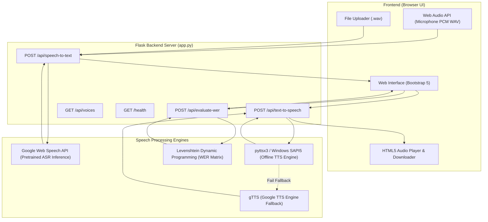

# VoiceFlow: Speech-to-Text & Text-to-Speech Conversion System

[](https://www.python.org/)
[](https://flask.palletsprojects.com/)
[](tests/test_app.py)
[](LICENSE)
[](Speech_Converter_Colab.ipynb)

A complete, beginner-friendly BCA college project built using **Python, Flask, pyttsx3, SpeechRecognition, and HTML5/Bootstrap 5**.

---

## 1. Project Introduction

The **Speech-to-Text and Text-to-Speech Conversion System** (VoiceFlow) is a two-way voice processing web application designed to bridge the gap between human voice and computer text. It provides two core functionalities alongside an educational evaluation tool:

1. **Speech-to-Text (STT):** Converts human spoken audio into editable text using a pretrained Automatic Speech Recognition (ASR) engine.
2. **Text-to-Speech (TTS):** Converts written text into human voice audio using an offline speech synthesis engine (`pyttsx3` with Windows SAPI5) with automatic fallback to `gTTS`.
3. **AI/ML Evaluation (Word Error Rate - WER):** Measures speech recognition accuracy by comparing transcribed text against a known reference transcript using the industry-standard Levenshtein Dynamic Programming algorithm.

> **Important College Note:** This project intentionally does **not** require Kaggle or external training datasets. It performs inference using pretrained speech models and evaluates accuracy algorithmically.

---

## 2. Problem Statement

Manual data entry and keyboard typing can be slow, tiring, and inaccessible for individuals with visual impairments, motor disabilities, or literacy challenges. Conversely, reading large blocks of digital text causes eye fatigue and is unsuitable for hands-free scenarios (e.g., driving or multitasking). 

There is a growing need for a unified, lightweight, and accessible system that can seamlessly convert voice to text and text to speech without requiring costly cloud subscriptions or high-end GPU workstations.

---

## 3. Project Objectives

- Develop a responsive, easy-to-use web interface for dual voice-text conversion.
- Implement **Speech-to-Text** supporting both local `.wav` file uploads and live microphone recording.
- Implement **Text-to-Speech** operating 100% offline on Windows with voice selection and speed control.
- Incorporate a client-side **Browser SpeechSynthesis fallback** in case server synthesis is unavailable.
- Provide an **AI/ML Evaluation Module** computing Word Error Rate (WER), substitutions, deletions, and insertions.
- Ensure the application is lightweight, beginner-friendly, and simple to run on standard student laptops as well as Google Colab.

---

## 4. Key Features

| Feature | Description | Engine / Library | Offline / Online |
|---|---|---|---|
| **Audio File Upload** | Upload uncompressed 16-bit PCM `.wav` files (up to 16MB). | Flask + Python `wave` | Local validation |
| **Microphone Recording** | Record live speech in the browser, encoded directly into 16-bit PCM WAV. | Web Audio API (`AudioContext`) | Browser capture |
| **Speech-to-Text** | Transcribe spoken words into editable digital text. | `SpeechRecognition` (Google Web Speech API) | Online inference |
| **Text-to-Speech** | Synthesize text into natural spoken audio with instant playback. | `pyttsx3` (Windows SAPI5) / `gTTS` | **Offline on Windows** / Online Fallback |
| **Audio Download** | Download synthesized speech as a `.wav` / `.mp3` file. | Flask Base64 Data Stream | Local |
| **Voice & Speed Controls** | Adjust speech rate (50–250 WPM) and select male/female system voices. | Windows SAPI5 Voices | Local |
| **Browser TTS Fallback** | Fallback client-side speech synthesizer. | HTML5 `window.speechSynthesis` | Client-side |
| **WER Evaluation** | Calculate Word Error Rate (WER) and recognition accuracy percentage. | Levenshtein Dynamic Programming | **100% Offline** |
| **Google Colab Support** | 1-Click execution on cloud GPU/CPU via Jupyter Notebook or Gradio. | `Speech_Converter_Colab.ipynb` | Cloud |

---

## 5. Technology Stack

- **Backend:** Python 3.10+ (tested on Python 3.13), Flask 3.1, `flask-cors`
- **Speech-to-Text Engine:** `SpeechRecognition` 3.17+ (using Google Speech API pretrained endpoint)
- **Text-to-Speech Engine:** `pyttsx3` 2.99+ (using native Windows SAPI5) and `gTTS` fallback
- **Windows COM Interface:** `pythoncom` / `pywin32`
- **Python 3.13 Audio Compatibility:** `audioop-lts`, `standard-aifc`
- **Frontend:** HTML5, CSS3, JavaScript (ES6+), Bootstrap 5.3, Bootstrap Icons
- **Cloud/Colab UI:** Gradio 4.0+
- **Testing:** `pytest` 8.0+

---

## 6. System Architecture



---

## 7. How to Run on Google Colab

You can run this project on Google Colab in **two easy ways**:

### Option A: Upload the Notebook (Easiest)
1. Open [Google Colab](https://colab.research.google.com/).
2. Click **Upload** and select `Speech_Converter_Colab.ipynb` from this repository.
3. Run **Cell 1** (Install dependencies).
4. Run **Cell 2** (Launch application).
5. Click the generated **public link (`https://xxxx.gradio.live`)** to open the interface!

### Option B: Run Standalone Python Script on Colab
```bash
!apt-get update -qq && !apt-get install -y -qq espeak espeak-ng ffmpeg
!pip install -q gradio SpeechRecognition gTTS pydub
!python colab_app.py
```

---

## 8. How to Run Locally on Windows

### Step 1: Open Terminal in Project Directory
```powershell
cd c:\Users\DELL\OneDrive\Desktop\speech-converter
```

### Step 2: Install Required Dependencies
```powershell
pip install -r requirements.txt
```

### Step 3: Run the Flask Application
```powershell
python app.py
```

### Step 4: Access in Web Browser
Open your browser and visit: **`http://127.0.0.1:5000/`**

---

## 9. Running Automated Tests

Run the test suite using `pytest`:

```powershell
python -m pytest tests/test_app.py -v
```

All 14 tests will execute, testing:
- Application startup and health check (`/health`)
- Voices enumeration (`/api/voices`)
- Text-to-Speech input validation and audio synthesis
- Speech-to-Text file validation and end-to-end transcription
- Word Error Rate (WER) mathematical calculation and dynamic programming backtracking

---

## 10. Project File Structure Explained

```
speech-converter/
│
├── app.py                      # Core Flask backend: routes, STT/TTS logic, WER dynamic programming
├── colab_app.py                # Standalone Gradio application for Google Colab
├── Speech_Converter_Colab.ipynb# Ready-to-use Jupyter Notebook for Google Colab
├── requirements.txt            # Python package dependencies
├── .gitignore                  # Git ignore rules for caches, venv, and temp files
├── LICENSE                     # MIT Open Source License
├── README.md                   # Comprehensive guide and GitHub documentation
├── PROJECT_REPORT.md           # Complete academic college project report for BCA
├── VIVA_QUESTIONS.md           # 20 viva voce questions with detailed answers
│
├── templates/
│   └── index.html              # Frontend single-page UI with tabs, forms, and cards
│
├── static/
│   ├── css/
│   │   └── style.css           # Clean blue-and-white styling, animations, and responsive layout
│   └── js/
│       └── script.js           # Client logic: Web Audio API WAV recorder, audio preview, API calls
│
└── tests/
    └── test_app.py             # 14 unit and integration tests (100% passing)
```

---

## 11. Word Error Rate (WER) Formula

Word Error Rate evaluates the difference between a reference transcript ($R$) and a recognized hypothesis ($H$):

$$\text{WER} = \frac{S + D + I}{N} \times 100\%$$

Where:
- **$S$ (Substitutions):** Words in reference replaced by different words.
- **$D$ (Deletions):** Words in reference missed by the recognizer.
- **$I$ (Insertions):** Words present in hypothesis that were not in reference.
- **$N$:** Total number of words in reference ($N = S + D + C$).
- **Accuracy:** $\max(0, 1 - \text{WER}) \times 100\%$.

The calculation runs locally in pure Python using a 2D dynamic programming matrix.

---

## 12. License

This project is licensed under the MIT License - see the [LICENSE](LICENSE) file for details.
