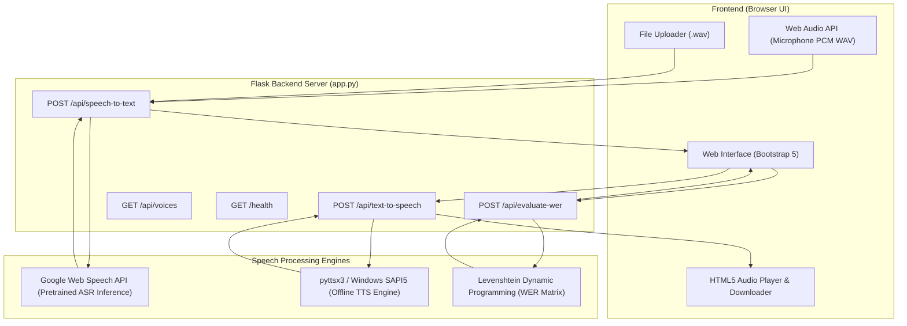

# Speech-to-Text and Text-to-Speech Conversion System

A complete, beginner-friendly BCA college project built using **Python, Flask, pyttsx3, SpeechRecognition, and HTML5/Bootstrap 5**.

---

## 1. Project Introduction

The **Speech-to-Text and Text-to-Speech Conversion System** (VoiceFlow) is a two-way voice processing web application designed to bridge the gap between human voice and computer text. It provides two core functionalities alongside an educational evaluation tool:

1. **Speech-to-Text (STT):** Converts human spoken audio into editable text using a pretrained Automatic Speech Recognition (ASR) engine.
2. **Text-to-Speech (TTS):** Converts written text into human voice audio using an offline speech synthesis engine (`pyttsx3` with Windows SAPI5).
3. **AI/ML Evaluation (Word Error Rate - WER):** Measures speech recognition accuracy by comparing transcribed text against a known reference transcript using the industry-standard Levenshtein Dynamic Programming algorithm.

> **Important College Note:** This project intentionally does **not** require Kaggle or external training datasets. It performs inference using pretrained speech models and evaluates accuracy algorithmically.

---

## 2. Problem Statement

Manual data entry and keyboard typing can be slow, tiring, and inaccessible for individuals with visual impairments, motor disabilities, or literacy challenges. Conversely, reading large blocks of digital text causes eye fatigue and is unsuitable for hands-free scenarios (e.g., driving or multitasking). 

There is a growing need for a unified, lightweight, and accessible system that can seamlessly convert voice to text and text to speech without requiring costly cloud subscriptions or high-end GPU workstations.

---

## 3. Project Objectives

- Develop a responsive, easy-to-use web interface for dual voice-text conversion.
- Implement **Speech-to-Text** supporting both local `.wav` file uploads and live microphone recording.
- Implement **Text-to-Speech** operating 100% offline on Windows with voice selection and speed control.
- Incorporate a client-side **Browser SpeechSynthesis fallback** in case server synthesis is unavailable.
- Provide an **AI/ML Evaluation Module** computing Word Error Rate (WER), substitutions, deletions, and insertions.
- Ensure the application is lightweight, beginner-friendly, and simple to run on standard student laptops.

---

## 4. Key Features

| Feature | Description | Engine / Library | Offline / Online |
|---|---|---|---|
| **Audio File Upload** | Upload uncompressed 16-bit PCM `.wav` files (up to 16MB). | Flask + Python `wave` | Local validation |
| **Microphone Recording** | Record live speech in the browser, encoded directly into 16-bit PCM WAV. | Web Audio API (`AudioContext`) | Browser capture |
| **Speech-to-Text** | Transcribe spoken words into editable digital text. | `SpeechRecognition` (Google Web Speech API) | Online inference |
| **Text-to-Speech** | Synthesize text into natural spoken audio with instant playback. | `pyttsx3` (Windows SAPI5) | **100% Offline** |
| **Audio Download** | Download synthesized speech as a `.wav` file. | Flask Base64 Data Stream | Local |
| **Voice & Speed Controls** | Adjust speech rate (50–250 WPM) and select male/female system voices. | Windows SAPI5 Voices | Local |
| **Browser TTS Fallback** | Fallback client-side speech synthesizer. | HTML5 `window.speechSynthesis` | Client-side |
| **WER Evaluation** | Calculate Word Error Rate (WER) and recognition accuracy percentage. | Levenshtein Dynamic Programming | **100% Offline** |

---

## 5. Technology Stack

- **Backend:** Python 3.10+ (tested on Python 3.13), Flask 3.1, `flask-cors`
- **Speech-to-Text Engine:** `SpeechRecognition` 3.17+ (using Google Speech API pretrained endpoint)
- **Text-to-Speech Engine:** `pyttsx3` 2.99+ (using native Windows SAPI5)
- **Windows COM Interface:** `pythoncom` / `pywin32`
- **Python 3.13 Audio Compatibility:** `audioop-lts`, `standard-aifc`
- **Frontend:** HTML5, CSS3, JavaScript (ES6+), Bootstrap 5.3, Bootstrap Icons
- **Testing:** `pytest` 8.0+

---

## 6. System Architecture



---

## 7. How the Features Work

### A. Speech-to-Text (STT)
1. **Audio Capture:** The user either uploads a `.wav` file or speaks into the microphone. In microphone mode, the browser's Web Audio API (`AudioContext` and `ScriptProcessorNode`) records raw audio samples and serializes them into a standard 44-byte RIFF header 16-bit PCM `.wav` Blob.
2. **Transmission:** The audio is sent to `/api/speech-to-text` via `multipart/form-data`.
3. **Validation & AudioFile Loading:** Flask validates the extension and file size, saves it to a temporary file, and loads it with `speech_recognition.AudioFile`.
4. **Pretrained Inference:** `recognizer.recognize_google(audio_data)` sends the acoustic data to Google's pretrained ASR model, which performs acoustic feature extraction, neural language decoding, and returns the recognized text string.
5. **Temporary Cleanup:** The temporary audio file on the server is immediately unlinked in a `finally:` block.

### B. Text-to-Speech (TTS)
1. **Input Validation:** The user submits text via POST to `/api/text-to-speech`. The server verifies that the text is non-empty and under 5,000 characters.
2. **SAPI5 COM Initialization:** To ensure thread safety in Flask's multi-threaded request pool, the server calls `pythoncom.CoInitialize()`.
3. **Speech Synthesis:** `pyttsx3` configures the selected voice, rate (WPM), and volume, and invokes `engine.save_to_file(text, temp_path)`.
4. **Base64 Encoding:** The synthesized `.wav` file is read into memory, base64 encoded into a `data:audio/wav;base64,...` URI, and returned in JSON.
5. **Immediate Playback:** The client sets the audio URI to the `<audio>` player for instant listening and enables the "Download Audio (.wav)" button.

### C. Word Error Rate (WER) Evaluation
Word Error Rate evaluates the difference between a reference transcript ($R$) and a recognized hypothesis ($H$):

$$\text{WER} = \frac{S + D + I}{N} \times 100\%$$

Where:
- **$S$ (Substitutions):** Words in reference replaced by different words.
- **$D$ (Deletions):** Words in reference missed by the recognizer.
- **$I$ (Insertions):** Words present in hypothesis that were not in reference.
- **$N$:** Total number of words in reference ($N = S + D + C$).
- **Accuracy:** $\max(0, 1 - \text{WER}) \times 100\%$.

The calculation runs locally in pure Python using a 2D dynamic programming matrix.

---

## 8. Hardware and Software Requirements

### Hardware Requirements
- **Processor:** Intel Core i3 (6th Gen or later) / AMD Ryzen 3 or equivalent.
- **RAM:** 4 GB minimum (8 GB recommended).
- **Disk Space:** 500 MB free space.
- **Peripherals:** Working microphone and speakers / headphones.

### Software Requirements
- **Operating System:** Windows 10 or Windows 11 (64-bit).
- **Python Version:** Python 3.10, 3.11, 3.12, or 3.13.
- **Web Browser:** Google Chrome, Microsoft Edge, or Mozilla Firefox.
- **Internet Connection:** Required for Google Speech Recognition (STT). Not required for TTS or WER evaluation.

---

## 9. Windows Installation & Execution Guide

### Step 1: Open Terminal in Project Directory
Open **PowerShell** or **Command Prompt** and navigate to your project directory:
```powershell
# Verify you are in the speech-converter directory
dir
```

### Step 2: Install Required Dependencies
Run:
```powershell
pip install -r requirements.txt
```
*(If on Python 3.13, pip will also install `audioop-lts` and `standard-aifc` automatically).*

### Step 3: Run the Flask Application
Run:
```powershell
python app.py
```

### Step 4: Access the Application
Open your web browser and go to:
```
http://127.0.0.1:5000/
```

---

## 10. Running Automated Tests

Run the test suite using `pytest`:

```powershell
python -m pytest tests/test_app.py -v
```

All 14 tests will execute, testing:
- Application startup and health check (`/health`)
- Voices enumeration (`/api/voices`)
- Text-to-Speech input validation and audio synthesis
- Speech-to-Text file validation and end-to-end transcription
- Word Error Rate (WER) mathematical calculation and dynamic programming backtracking

---

## 11. Project File Structure Explained

```
speech-converter/
│
├── app.py                  # Core Flask backend: routes, STT/TTS logic, WER dynamic programming
├── requirements.txt        # Python package dependencies
├── README.md               # Beginner-friendly guide and documentation
├── PROJECT_REPORT.md       # Complete academic college project report
├── VIVA_QUESTIONS.md       # 20 viva voce questions with detailed answers
│
├── templates/
│   └── index.html          # Frontend single-page UI with tabs, forms, and cards
│
├── static/
│   ├── css/
│   │   └── style.css       # Clean blue-and-white styling, animations, and responsive layout
│   └── js/
│       └── script.js       # Client logic: Web Audio API WAV recorder, audio preview, API calls
│
└── tests/
    └── test_app.py         # 14 unit and integration tests
```

---

## 12. Common Errors and Solutions

### 1. `ModuleNotFoundError: No module named 'audioop'` (Python 3.13)
- **Reason:** In Python 3.13, `audioop` was deprecated and removed from the standard library.
- **Solution:** Install the backport: `pip install audioop-lts standard-aifc`. (Already included in `requirements.txt`).

### 2. COM / Threading error in pyttsx3 (`CoInitialize has not been called`)
- **Reason:** Windows SAPI5 uses Microsoft COM apartments. Flask handles requests in separate worker threads.
- **Solution:** Our `app.py` wraps TTS synthesis calls with `pythoncom.CoInitialize()` and `pythoncom.CoUninitialize()`.

### 3. Microphone Access Blocked in Browser
- **Reason:** Browsers block microphone access unless permitted or running on `localhost`/`127.0.0.1`.
- **Solution:** Click the lock or settings icon in your browser address bar and set Microphone to **Allow**.

### 4. `speech_recognition.RequestError`
- **Reason:** The computer is not connected to the internet during Speech-to-Text.
- **Solution:** Connect your PC to Wi-Fi/Internet for the STT feature (Google Web Speech API). TTS and WER will continue to work offline.

---

## 13. Advantages and Limitations

### Advantages:
- **Zero Cost:** Uses free, open-source libraries without paid subscriptions or API keys.
- **No Heavy Datasets:** Runs without downloading multi-gigabyte training datasets.
- **100% Offline TTS:** Speech synthesis does not consume internet bandwidth or lag.
- **Dual Synthesis Engines:** Includes both server-side SAPI5 and browser Web Speech fallback.
- **Quantitative Evaluation:** Educational WER tool provides objective accuracy scores.

### Limitations:
- STT requires active internet connection (due to cloud ASR endpoint).
- Audio format is strictly restricted to uncompressed 16-bit PCM WAV (unless FFmpeg is separately installed).
- Pyttsx3 offline voice variety depends on the voices pre-installed in Windows.

---

## 14. Future Scope

1. **Local Offline STT:** Integrate offline speech recognition models like Vosk or Whisper-base for complete offline operation.
2. **Multi-Language Support:** Add recognition and synthesis for regional languages (e.g., Hindi, Spanish, French).
3. **Real-Time Live Captioning:** Stream microphone audio over WebSockets for live real-time transcription.
4. **Noise Cancellation:** Add digital signal processing (DSP) filters to suppress background noise before transcription.
